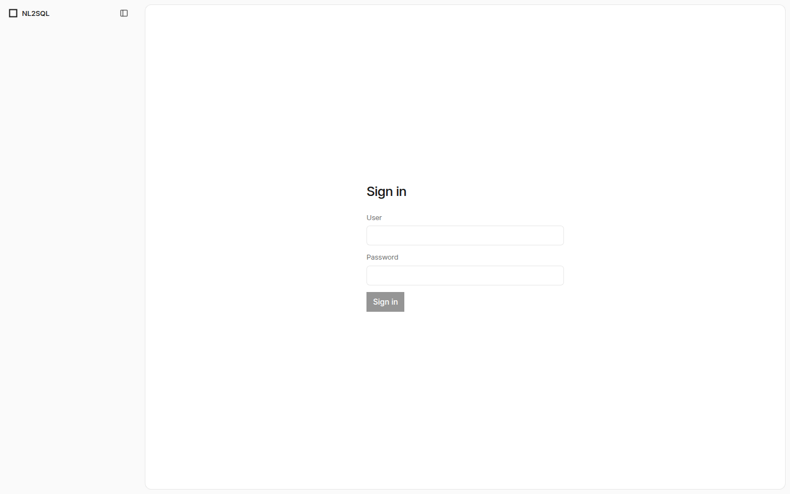
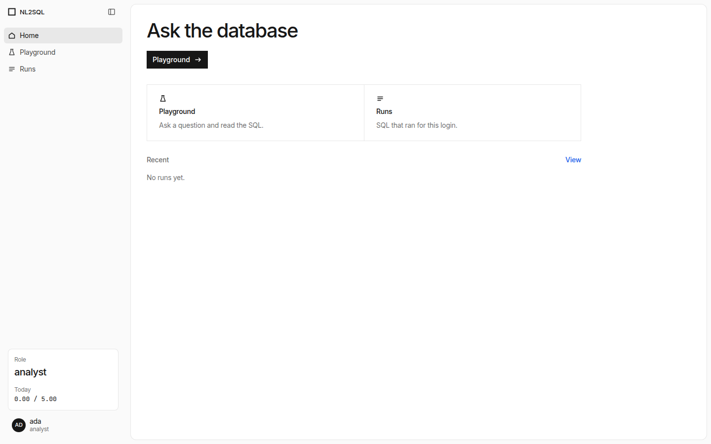
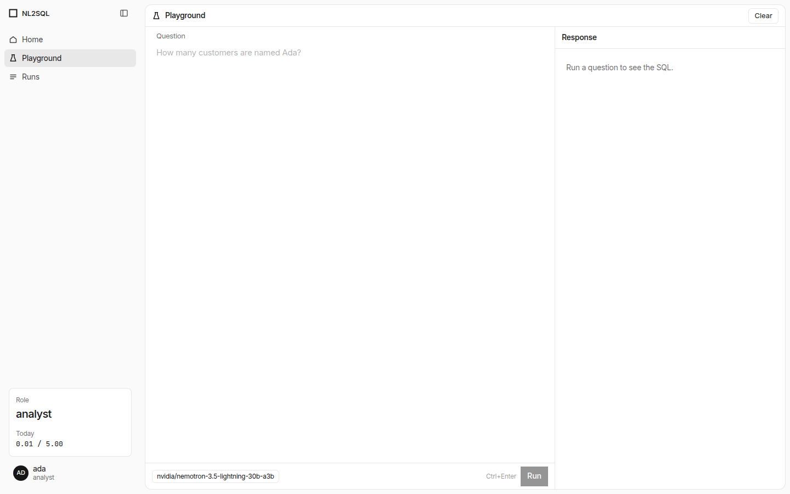
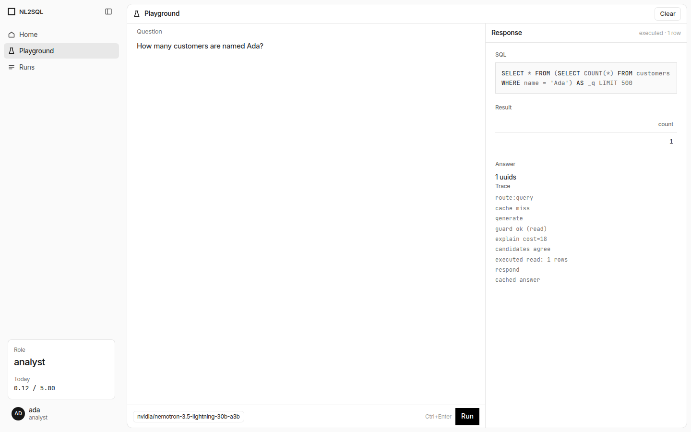
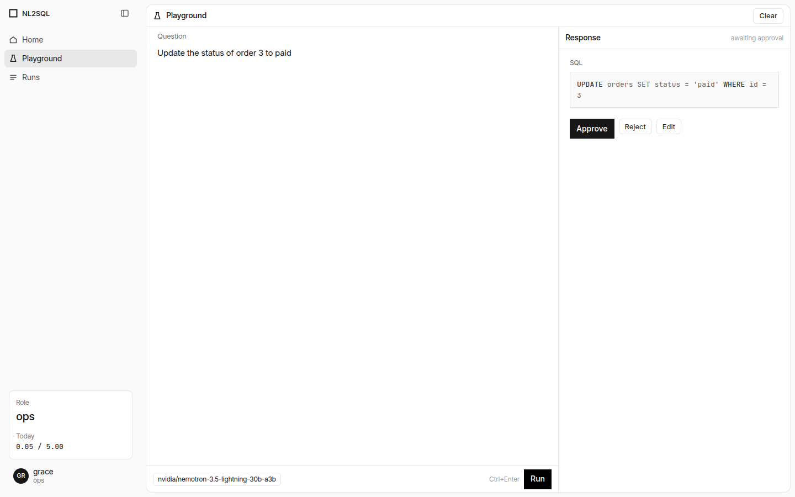
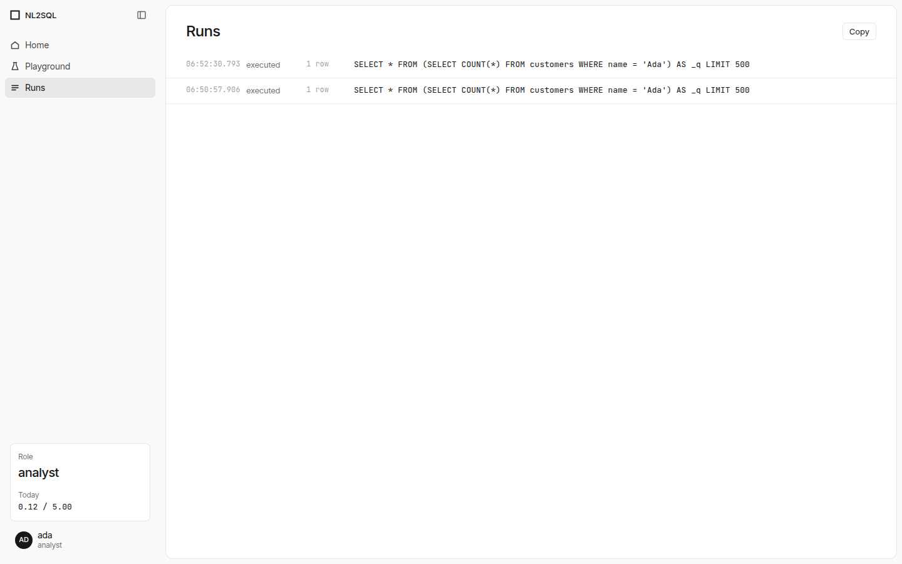

# NL2SQL

NL2SQL takes a natural-language question, turns it into one PostgreSQL statement, and runs that statement as the signed-in database role.

- The schema comes from the tables that role's login can see. `config.yaml` sets who may write and the row caps. It does not name the database.
- The guard allows one statement. It rejects DDL, nested writes, blocked functions, other schemas, and tables outside the loaded set.
- Writes, and reads the planner marks as expensive, stop for a person to approve, reject, or edit.
- The API signs the user in and stores an opaque Redis session. The CLI calls the same question code.
- Redis enforces a per-minute request cap and a daily model budget.
- OpenAI, Groq, NVIDIA, and Ollama can answer. Langfuse traces, LangCache, and mem0 memory are optional and do not change the role or the database login.

## Prerequisites

- Python 3.12
- Docker with Compose
- One model credential: `OPENAI_API_KEY`, `GROQ_API_KEY`, `NVIDIA_API_KEY`, or `OLLAMA_BASE_URL`
- Host ports 5432, 6379, and 8000 free when using [docker-compose.yml](docker-compose.yml)

## Getting Started

1. `python3.12 -m venv .venv && .venv/bin/pip install -r requirements.txt`
2. `cp .env.example .env` and fill the keys and DSNs. Policy and prices stay in [config.yaml](config.yaml). An environment value overrides the same setting in that file.
3. `docker compose up --build` starts Postgres, Redis, and the API on port 8000. The sample databases and users (`ada` / `ada` as analyst, `grace` / `grace` as ops) are created only on a new Postgres volume.
4. Local CLI, against those services: `NL2SQL_PASSWORD=ada .venv/bin/python run.py ada "how many customers"`
5. Console, from [web/](web/): `npm install`, then `npm run dev`. Open `http://127.0.0.1:3000`.

## Usage / Examples

Local CLI, against those services: `NL2SQL_PASSWORD=ada .venv/bin/python run.py ada "how many customers"`

Sign in, ask in the Playground, approve a write, and read Runs.

## Configuration

Policy, limits, and prices live in [config.yaml](config.yaml). Secrets and DSNs live in `.env`, copied from [.env.example](.env.example). An environment value overrides the same YAML setting. The AWS shape of this app is described in [aws/README.md](aws/README.md).

## Contributing

1. Fork the project.
2. Create your feature branch (`git checkout -b feature/Your-Feature`).
3. Commit your changes (`git commit -m 'Add some Your-Feature'`).
4. Push to the branch (`git push origin feature/Your-Feature`).
5. Open a Pull Request.

## License

This project is licensed under the MIT License. See [LICENSE](LICENSE).
