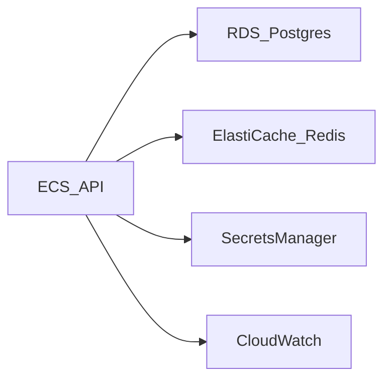

# AWS shape

This folder is a deploy description. It is not a running AWS account.

[docker-compose.yml](../docker-compose.yml) starts Postgres, Redis, and the API directly. The files here describe those same jobs in AWS terms. [MiniStack](https://github.com/ministackorg/ministack) reads the Terraform on this machine and starts real Postgres, Redis, and the API container. A real account would remove the MiniStack endpoint, push the image to a registry, and apply the same template there.



- ECS runs the API container from [Dockerfile](../Dockerfile). On MiniStack the task uses the host network, so the process can open the database and cache endpoints MiniStack returns. It listens on port 8000.
- RDS for PostgreSQL is the database. The sample roles and tables still come from [docker/postgres/init.sh](../docker/postgres/init.sh).
- ElastiCache is Redis.
- Secrets Manager holds the Redis URL and the database addresses.
- CloudWatch holds the API log group.

MiniStack's engine image is `postgres:16-alpine`. That image has no pgvector files, so `CREATE EXTENSION vector` fails and `init.sh` stops on the memory database. The parameter group `nl2sql-pg16` still sets `shared_preload_libraries` to `vector`, which is the extension the memory database needs. Amazon RDS for PostgreSQL 16 can create that extension. This local engine cannot.

Kubernetes, Lambda, and App Runner are not in this shape. Terraform is the only infrastructure-as-code tool here.

## Run it on MiniStack

MiniStack listens on `http://localhost:4566`. The Docker socket lets it start the database, the cache, and the API container.

```bash
docker build -t nl2sql-api:local .
docker run -d --name nl2sql-ministack -p 4566:4566 \
  -v /var/run/docker.sock:/var/run/docker.sock ministackorg/ministack
cd aws
terraform init
terraform apply
```

`terraform apply` talks only to that local endpoint. The access key is the test value `test`. The task sets `NVIDIA_API_KEY` to `local-proof` so the process can start. A real account replaces that value with a secret.
